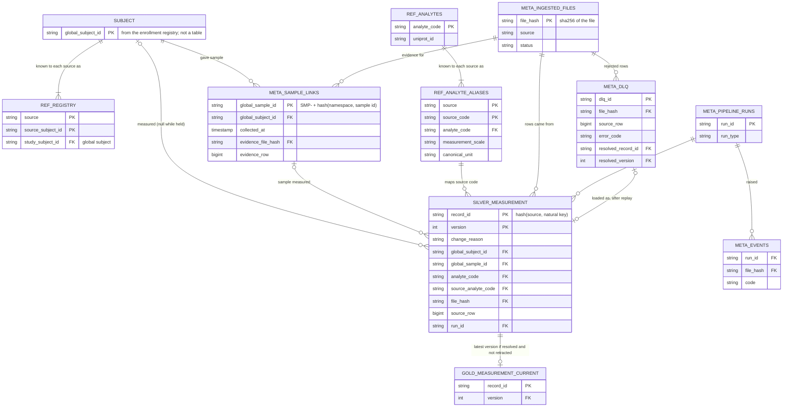

# Data Model

Canonical model for silver and gold, the identity model, metadata tables, and how identifiers and hashes
are computed. Related: [DESIGN.md](DESIGN.md), [ERROR_CATALOG.md](ERROR_CATALOG.md).

---

## 1. Overview

```
Inputs                  Reference data (versioned, in git)        Metadata (warehouse.duckdb, meta schema)
──────                  ─────────────────────────────────         ──────────────────────────
source files            analytes, analyte_aliases,                ingested_files, pipeline_runs,
enrollment registry     unit_aliases, unit_conversions,           run_stage_metrics, dlq, events,
                        value_ranges, source contracts, rules     schema_drift, sample_links

                 silver.measurement  (every version of every record)
                          │
                          ▼
gold.measurement_current · gold.dim_subject · gold.dim_sample · gold.dim_analyte
```

### Entities, keys and relationships



- **Keys are deterministic hashes, not counters**: `file_hash`, `record_id`, `global_sample_id`. A replay
  from bronze produces the same keys, so it produces the same tables.
- **A measurement is a versioned entity**: primary key (`record_id`, `version`), append-only. Gold holds
  one row per `record_id`: its latest version, if resolved and not retracted.
- **Two crosswalks carry identity**: the registry maps (source, source subject ID) to a person;
  `sample_links` maps a sample to a person, with the file and row that said so.
- **Foreign keys are logical, not declared.** Integrity comes from writing each file's rows, rejects,
  links and status in one transaction, and is checked by row accounting and the ground-truth comparison.
  Iceberg on AWS has no foreign keys either, so the same approach carries over.
- Not shown: `gold.dim_*` (derived from gold and `sample_links`), `meta.schema_drift`
  (key: source, column), `meta.run_stage_metrics`, and the unit and range reference tables.

---

## 2. Identity model

### 2.1 Subjects

Global subject IDs **come from the enrollment registry**; the pipeline does not mint them
([ADR-006](decisions/ADR-006-entity-resolution-registry.md)).

Registry file (`config/registry/enrollment.csv`):

| Column | Example | Meaning |
|---|---|---|
| `study_subject_id` | G-0001 | Global subject ID |
| `source` | lab_b | Source system |
| `source_subject_id` | P001 | That source's identifier for the person |

Because IDs come from a versioned input rather than a counter, a full replay produces the same global IDs.

### 2.2 Samples

Sample identifiers are scoped to a **sample namespace**, configured per source. Sources that share
physical samples share a namespace (assumption A2):

| Source | Sample namespace |
|---|---|
| lab_a | `study_biobank` |
| olink | `study_biobank` |
| metabolomics (planned) | `study_biobank` |
| lab_b | `lab_b` |
| ehr_vitals | — (no samples) |

`global_sample_id = "SMP-" + sha256(namespace + "|" + source_sample_id)[:16]`

So Lab A `S100` and Olink `S100` are the same sample; Lab B `S100`, if it existed, would be a different one.
Deterministic, so replay-stable.

### 2.3 Sample → subject links

Derived from source rows that state both a person and a sample (Lab A, Lab B). Each link records its
evidence and the sample's collection time, which becomes the observed time for any measurement on that
sample (including proteomics, assumption A5).

A sample linked to two different subjects is an identity conflict: affected rows are held, never merged
(see [ERROR_CATALOG.md](ERROR_CATALOG.md), `H003`).

---

## 3. Hashes and versioning

| Identifier | Definition | Purpose |
|---|---|---|
| `file_hash` | sha256 of file bytes | Duplicate delivery detection; bronze file name |
| `record_id` | sha256(`source` + natural key values) | Which real-world result this row is |
| `source_hash` | sha256 of the mapped source fields as delivered (value, unit, codes, dates, status) | Did the **vendor** change it? |
| `derived_hash` | sha256 of canonical derived fields (normalized value and unit, global IDs, observed time, flags) | Did **our derivation** change it (reference data fix, new identity link)? |

Natural keys:

| Source | Natural key |
|---|---|
| ehr_vitals | `patient_id`, `encounter_id`, `vital_type`, `recorded_at` |
| lab_a | `sample_id`, `analyte` |
| lab_b | `specimen`, `test_code` |
| olink | `SampleID`, `UniProtID` |
| metabolomics (planned) | `sample_id`, metabolite column name (after wide → long) |

(Olink can measure the same protein on more than one panel under different assay IDs; the prototype keys
on UniProt ID and documents this.)

**When a new version is written** for an existing `record_id`:

| Situation | `change_reason` |
|---|---|
| First time seen | `NEW` |
| `source_hash` differs, result status `C` | `SOURCE_CORRECTION` |
| `source_hash` differs, no `C` status | `SOURCE_CORRECTION` + warning `W004` |
| Result status `W` | `RETRACTION` (tombstone: excluded from gold) |
| Only `derived_hash` differs, held row now resolved | `RESOLVED` |
| Only `derived_hash` differs, otherwise | `DERIVATION_CHANGE` (e.g. unit table fix) |
| Both hashes identical | No write |

Separating the two hashes answers "who changed this value — the vendor or us?" for every version.

Files are processed in `received_at` order, so version numbering is deterministic on replay.

---

## 4. Silver: `measurement`

One row per version of each record. Append-only. Table `silver.measurement` in the warehouse (ADR-005).

| Column | Type | Notes |
|---|---|---|
| **Identity and versioning** | | |
| `record_id` | string | §3 |
| `version` | int | 1, 2, … |
| `change_reason` | enum | §3 |
| `is_retraction` | bool | Tombstone |
| `source_hash` | string | §3 |
| `derived_hash` | string | §3 |
| **Who and what** | | |
| `domain` | enum | `operational`, `scientific` |
| `source` | string | `ehr_vitals`, `lab_a`, `lab_b`, `olink` |
| `global_subject_id` | string, nullable | Null while held |
| `global_sample_id` | string, nullable | Null for vitals |
| `source_subject_id` | string, nullable | As delivered |
| `source_sample_id` | string, nullable | As delivered |
| `source_encounter_id` | string, nullable | Vitals only |
| `analyte_code` | string | Canonical, e.g. `CRP`, `HEART_RATE` |
| `assay` | string | `standard`, `high_sensitivity`, `olink_npx`, `vital_sign` |
| `source_analyte_code` | string | As delivered, e.g. `HSCRP` |
| **Value** | | |
| `value` | double | Normalized |
| `unit` | string | Canonical unit for the analyte (`mg/L`, `bpm`, `NPX`) |
| `measurement_scale` | enum | `absolute`, `relative_log2` (proteomics NPX); `relative` reserved for metabolomics (planned) |
| `source_value` | string | Exactly as delivered |
| `source_unit` | string, nullable | Exactly as delivered |
| **Time** | | |
| `observed_at` | timestamp (UTC), nullable | Biological time; for samples = collection time. Null while held. |
| `observed_at_precision` | enum | `minute`, `date` |
| `assay_run_date` | date, nullable | Proteomics run date, kept separately |
| **Quality and status** | | |
| `result_status` | enum, nullable | Lab sources: `P`, `F`, `C`, `W` |
| `qc_flag` | string, nullable | Proteomics: `PASS`, `WARN` |
| `quality_flags` | list<string> | Warning codes, e.g. `[W002]` |
| `resolution_status` | enum | `resolved`, `held` |
| `hold_reason` | string, nullable | Hold code, e.g. `H002` |
| **Lineage** | | |
| `source_file` | string | Original file name |
| `file_hash` | string | Points to bronze |
| `source_row` | int | Row number in the source file |
| `source_locator` | string, nullable | Position within the row for reshaped files: column name (wide) or record path (nested); null for long files |
| `contract_version` | string | e.g. `lab_b_v1` |
| `run_id` | string | Run that wrote this version |
| `ingested_at` | timestamp | |
| `pipeline_version` | string | Package version (`omics_pipeline.__version__`) |
| `reference_version` | string | Hash of reference data files |
| `registry_version` | string | Hash of the registry file |

Current version of a record = highest `version` per `record_id`.

---

## 5. Gold

Rebuilt from silver each run ([ADR-003](decisions/ADR-003-full-gold-rebuild.md)).

### `gold.measurement_current`
Latest version per `record_id`, where `is_retraction = false` and `resolution_status = resolved`.
Columns: `record_id`, `version`, `global_subject_id`, `global_sample_id`, `domain`, `source`,
`analyte_code`, `assay`, `value`, `unit`, `measurement_scale`, `observed_at`, `observed_at_precision`,
`result_status`, `qc_flag`, `quality_flags`. Preliminary results (`P`) are included and identifiable by
`result_status`.

Lineage is one join away: `record_id` + `version` → silver.

### `gold.dim_subject`
`global_subject_id`, first and last `observed_at`, measurement counts (total, operational, scientific),
and the list of sources that measured the person.

### `gold.dim_sample`
`global_sample_id`, `global_subject_id`, `collected_at`, `evidence_source` (the source that linked it),
and `measured_by` (sources with current measurements on it). One row per linked sample.

### `gold.dim_analyte`
From reference data: `analyte_code`, name, UniProt ID where applicable, and per source its aliases,
assay, canonical unit and measurement scale.

**Rule for consumers of gold:** values with different `measurement_scale` are never combined in one
aggregate; any aggregate groups by `analyte_code`, `assay` and `measurement_scale`. Gold keeps the scale
on every row so this is possible; no aggregate views are built today.

---

## 6. Reference data (versioned files)

| File | Columns | Example |
|---|---|---|
| `analytes.csv` | `analyte_code`, `name`, `uniprot_id` | `CRP, C-reactive protein, P02741` |
| `analyte_aliases.csv` | `source`, `source_code`, `analyte_code`, `assay`, `measurement_scale`, `canonical_unit` | `lab_b, HSCRP, CRP, high_sensitivity, absolute, mg/L` · `olink, P02741, CRP, olink_npx, relative_log2, NPX` |
| `unit_aliases.csv` | `raw_unit`, `unit` | `beats/min, bpm` · `mg/dl, mg/dL` (added in demo step 7) |
| `unit_conversions.csv` | `from_unit`, `to_unit`, `factor` | `ug/L, mg/L, 0.001` · `mg/dL, mg/L, 10` |
| `value_ranges.csv` | `analyte_code`, `unit`, `hard_min`, `hard_max`, `soft_min`, `soft_max` | Illustrative values, to be confirmed by a domain expert |
| `sources/<source>_v<N>.yaml` | Format (`csv`, `tsv`), layout (`long`), column mapping with types, formats, defaults and timezone; natural key; sample namespace; domain; `ignored_columns` / `forbidden_columns` | One per contract version ([ADR-010](decisions/ADR-010-pluggable-source-adapters.md)). JSON and wide / nested layouts are designed, not built |

Row rules are not a separate file: structural rules come from the contract (required fields, types,
formats, allowed values) and semantic rules from the reference data above; `rules.py` compiles both to
SQL ([ADR-007](decisions/ADR-007-validation-sql-rules.md)).

Canonical unit and measurement scale belong to the alias (source + code), not the analyte: CRP is
measured in absolute mg/L by the labs and in relative NPX by proteomics.

Unit conversion is multiplicative only. Non-multiplicative conversions (e.g. °F → °C) are not needed by
the current sources and are out of scope.

Proteomics values are stored with unit `NPX` and scale `relative_log2` (metabolomics, when added, would
use unit `relative_intensity` and scale `relative`). No conversion entries exist for relative units, so any
attempt to convert them fails validation, and different relative scales are never combined.

---

## 7. Metadata tables

### `ingested_files`
| Column | Notes |
|---|---|
| `file_hash` | PK |
| `source`, `original_name`, `received_at` | |
| `bronze_path`, `quarantine_path` | |
| `contract_version` | Contract the file was validated against |
| `status` | `COMMITTED` or `QUARANTINED`. A file that failed mid-way has no row: it stays in landing and is retried |
| `quarantine_code`, `quarantine_reason` | e.g. `F004` and the expected vs received columns |
| `last_run_id` | |
| `columns` | Header as received; feeds schema-drift tracking |

### `pipeline_runs`
| Column | Notes |
|---|---|
| `run_id` | PK |
| `run_type` | `ingest`, `replay`, `dlq_replay` |
| `started_at`, `finished_at`, `status` | |
| `pipeline_version`, `reference_version`, `registry_version` | |
| `files_in`, `files_committed`, `files_quarantined`, `files_duplicate`, `files_failed` | |
| `rows_in`, `rows_ok`, `rows_warn`, `rows_dlq`, `rows_held`, `rows_filtered` | Accounting: `rows_in = rows_ok + rows_dlq + rows_held + rows_filtered` (`rows_warn` is a subset of `rows_ok`) |
| `rows_resolved` | Held rows resolved at the end of the run |

Peak memory is measured by the benchmark, not stored per run.

### `run_stage_metrics`
`run_id`, `file_hash`, `stage`, `duration_ms`, `rows_in`, `rows_out`. Feeds the benchmark (DESIGN §10.5).

### `dlq`
| Column | Notes |
|---|---|
| `dlq_id` | sha256(`file_hash`, `source_row`, `error_code`, `field`) |
| `file_hash`, `source_file`, `source_row`, `source`, `run_id` | |
| `error_code`, `field`, `contract_version` | |
| `raw_value`, `raw_row` | The rejected value and the whole row as JSON |
| `status` | `OPEN`, `RESOLVED` (`DISCARDED` is designed; no command sets it yet) |
| `attempts`, `updated_at` | |
| `resolved_record_id`, `resolved_version` | Set when replay succeeds |

### `events`
`run_id`, `event_type`, `severity`, `code`, `source`, `file_name`, `file_hash`, `detail`, `raised_at`.
Everything that needs a person: quarantines, schema drift, distribution shifts, failures. No primary key;
append-only.

### `schema_drift`
| Column | Notes |
|---|---|
| `source`, `column_name` | PK |
| `status` | `OPEN`, `IGNORED`, `FORBIDDEN`, `ADOPTED`; follows the contract, never edited by hand |
| `first_seen_file`, `first_seen_at`, `last_seen_at`, `files_seen` | |
| `decided_in` | Contract version whose configuration decided the current status |

### Subject links
Not a table: subjects are linked by joining source IDs to the registry snapshot (`ref.registry`); each
silver row records the `registry_version` used.

### `sample_links`
`global_sample_id`, `global_subject_id`, `collected_at`, `evidence_source`, `evidence_file_hash`,
`evidence_row`, `run_id`. A second, different `global_subject_id` for the same sample raises `H003`.

---

## 8. Worked example

Lab B row: `P001, S200, HSCRP, 3200, ug/L, 2026-03-01` (file `lab_b_sample.csv`, row 1; no status
column, so `result_status` defaults to `F`)

| Field | Value |
|---|---|
| `record_id` | sha256(`lab_b` + `S200` + `HSCRP`) |
| `global_subject_id` | `G-0001` (registry: lab_b / P001) |
| `global_sample_id` | `SMP-` + hash(`lab_b` + `S200`) |
| `analyte_code` / `assay` | `CRP` / `high_sensitivity` |
| `value` / `unit` | `3.2` / `mg/L` (3200 × 0.001) |
| `source_value` / `source_unit` | `3200` / `ug/L` |
| `measurement_scale` | `absolute` |
| `observed_at` | `2026-03-01` (precision `date`) |
| `result_status` | `F` |
| `version` / `change_reason` | `1` / `NEW` |

Olink row: `S100, CRP, P02741, 10.4, PASS, 2026-03-05`

| Field | Value |
|---|---|
| `global_sample_id` | `SMP-` + hash(`study_biobank` + `S100`) — same as Lab A's S100 |
| `global_subject_id` | From `sample_links` (Lab A row for S100) → `G-0001`; if not yet known → held (`H002`) |
| `value` / `unit` / `measurement_scale` | `10.4` / `NPX` / `relative_log2` |
| `observed_at` | `2026-01-10` (Lab A collection date), not the run date |
| `assay_run_date` | `2026-03-05` |
