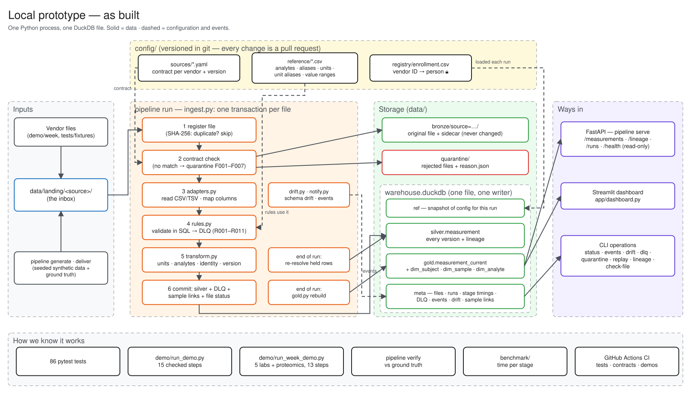
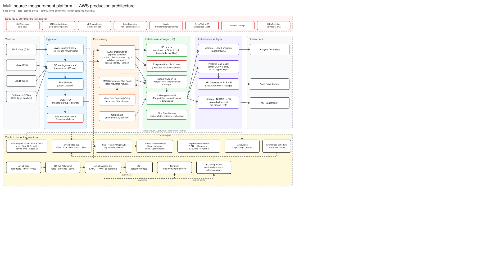

# Design: Multi-Source Measurement Pipeline

Status: **Draft v0.3.** All decisions recorded in [decisions/](decisions/); each can be revisited.

Related documents: [DATASETS.md](DATASETS.md) (source data) · [DATA_MODEL.md](DATA_MODEL.md) (canonical model, identity, hashes) · [ERROR_CATALOG.md](ERROR_CATALOG.md) (error codes) · [decisions/](decisions/) (ADRs)

---

## 1. Problem and success criteria

Measurement data about the same people arrives from several independent sources: clinic vital signs,
two clinical labs, and a proteomics vendor. Each source uses its own column names, identifiers, units,
codes and dates. Some values are absolute concentrations; others are relative scores. Files arrive in
any order, can be resent, and can contain corrections or errors.

The system must turn these into **one trustworthy, comparable dataset**, where every value can be traced
back to the exact file and row it came from, and where reprocessing anything is always safe.

**Success looks like:**

- Data from every source appears in one canonical model, comparable where comparison is valid and
  explicitly separated where it is not.
- Every input row is accounted for: accepted, rejected with a reason, held pending resolution, or filtered as an expected non-data row.
- Any output value can be traced to its source file, row, run and transformation versions.
- Rerunning, replaying or receiving duplicate files never changes correct results.
- A new source can be added through configuration, without changing pipeline code.

---

## 2. Domain and data

Four sources (full column-by-column reference in [DATASETS.md](DATASETS.md)):

| Source | Measures | Identified by | Domain |
|---|---|---|---|
| EHR vitals | Heart rate, blood pressure at a clinic visit | Person + visit | Operational |
| Lab A | CRP in a blood sample, absolute (mg/L) | Person + sample | Scientific |
| Lab B | hs-CRP in a blood sample, absolute (ug/L) | Person + sample | Scientific |
| Proteomics (Olink) | Thousands of proteins per sample, **relative** (NPX, log2) | **Sample only** | Scientific |

```
  Person ──┬── EHR vitals   (person, visit)
           ├── Lab A        (person, sample S100) ◀──┐ same sample
           ├── Lab B        (person?, sample S200)   │
           └ ─ Proteomics   (sample S100 only) ──────┘  person found only via Lab A
```

What makes this harder than a format conversion is summarized in §9.

---

## 3. Assumptions

| # | Assumption | Why | Impact if wrong |
|---|---|---|---|
| A1 | Identifiers are **scoped to their source**: `P001` in Lab A is not assumed to be `P001` in Lab B | Independent organizations number independently | If we assumed the opposite and were wrong, two people's data would be merged (dangerous). Linking across sources requires evidence from an enrollment registry ([ADR-006](decisions/ADR-006-entity-resolution-registry.md)). |
| A2 | Sample IDs are shared between Lab A and the proteomics vendor | The same physical tube is split into aliquots | Proteomics rows cannot be linked to a person and stay `HELD` |
| A3 | NPX values are relative (log2) and **never converted** to concentration | NPX is normalized within a run; no conversion factor exists | Mixing NPX with mg/L would produce meaningless analytics |
| A4 | Timestamps without a timezone are in one configured zone; stored as UTC | Sources omit timezone | Time-ordering across sources could shift by hours |
| A5 | A measurement's biological date is the **sample collection date**, not the assay run date | Analysis is about the body's state when sampled | Proteomics results would be misaligned in time by weeks |
| A6 | Corrections and retractions arrive as resent records with the same natural key and a result status (HL7 v2 OBX-11: `C` corrects a final result, `W` withdraws a wrong one) | Standard lab messaging behavior | A correction under a new key would appear as a second, conflicting value; an unhandled retraction would leave a wrong result in gold |
| A7 | Batch, file-by-file delivery; no streaming requirement | Lab and vendor deliveries are batch files | Streaming sources would need a different ingestion front end |
| A8 | All data in this repository is synthetic | No real health data is used | — |

---

## 4. Functional requirements

| ID | Requirement |
|---|---|
| FR-1 | Ingest files from multiple sources; detect and skip duplicate deliveries |
| FR-2 | Validate each file against a versioned source contract; quarantine files that fail |
| FR-3 | Validate each row; reject invalid rows to a dead-letter queue with a reason; flag warnings without rejecting |
| FR-4 | Normalize to a canonical model: column mapping, unit conversion, analyte mapping, measurement scale |
| FR-5 | Resolve source identifiers to global subject and sample IDs; hold rows that cannot yet be resolved |
| FR-6 | Version records: apply corrections as new versions and retractions as tombstone versions; keep history |
| FR-7 | Handle late-arriving data, including dependencies between sources |
| FR-8 | Record lineage for every row (source file, row, run, transformation versions) |
| FR-9 | Expose harmonized data and lineage through a read-only access layer |
| FR-10 | Provide operations to rerun, replay from raw, replay rejected rows and report run status |
| FR-11 | Keep operational and scientific pipelines separate while sharing reference entities |
| FR-12 | Support source format changes by adding contract versions |

---

## 5. Non-functional requirements

| NFR | Target | Verified by |
|---|---|---|
| Idempotency | Reprocessing any input changes nothing | Run-twice test |
| Completeness | `rows_in = ok + dlq + held + filtered` for every run | Invariant in code and tests |
| Traceability | 100% of silver/gold rows link to source file, row and run | Test; lineage endpoint |
| Reproducibility | Rebuild from bronze yields identical content | Replay test |
| Fault isolation | One bad file or source never blocks others | Scenario test |
| Recoverability | Interrupted run → rerun → correct result | Interrupt test |
| Extensibility | New source = configuration + reference data, no pipeline code; new file format or shape = an adapter, not a pipeline change | All sources added by configuration; Labs C, D and E onboarded with configuration only in the week demo; TSV reader built, wide and nested shapes designed, not built |
| Performance | Throughput and memory targets on a single machine — *TBD from benchmark* | Benchmark ladder (§10) |
| Security and privacy | Synthetic data only; global IDs in gold; raw and rejected data treated as PHI | Design review (§11) |
| Observability | Per-stage timing and row counts recorded for every run | Metadata tables; `pipeline status` |

---

## 6. Scope

**In scope:** the four sources; a pluggable source-adapter layer with CSV and TSV readers (wide and nested
shapes designed, not built); three further labs onboarded by configuration only; file and row validation; normalization; deterministic entity resolution;
versioning of corrections; late data; lineage; replay; read-only access API; scenario fixtures; volume
generator and benchmarks; containerized local run.

| Out of scope | Reason |
|---|---|
| Probabilistic entity resolution | No demographic fields to match on; conservative deterministic linking is safer |
| Olink batch bridging normalization | Scientific normalization, not platform responsibility; would be a downstream step |
| Manual data overrides | Breaks provenance; see [ADR-004](decisions/ADR-004-no-manual-dlq-overrides.md) |
| Streaming ingestion | Sources deliver batch files (A7) |
| OpenLineage integration | Lineage is captured in tables; standard export is a production step |
| Censored lab values (`<0.3`, `>200`) | Realistic but not needed for a required capability; would add a value qualifier ([ADR-008](decisions/ADR-008-data-realism.md)) |
| Live AWS deployment | Design is documented (§11); a polished local system is the priority |

---

## 7. Architecture and design



### 7.1 Flow

```
 Sources                                PIPELINE (one run per file)                         Consumers
 ───────                                ───────────────────────────                         ─────────
 EHR vitals ─┐
 Lab A ──────┤──▶ landing/ ──▶ [1 register] ──▶ [2 file checks] ──fail──▶ quarantine/
 Lab B ──────┤                     │                  │
 Olink ──────┤                     ▼                  ▼ pass
 Registry ───┘               metadata DB         bronze/  (raw copy, immutable)
                                                      ▼
                                              [3 adapter: read → shape → map]
                                                      ▼
                                              [4 row rules] ──reject──▶ meta.dlq
                                                      │ ──unresolved──▶ silver (status=HELD)
                                                      ▼ ok / warn
                                              [5 normalize units + analytes]
                                              [6 resolve identity]
                                              [7 record_id, hashes, version]
                                                      ▼
                                                silver.measurement  (canonical, versioned)
                                                      ▼
                                              [8 build gold]
                                                      ▼
                                                 gold.*  ──────────▶ Access API ──▶ apps, analysts
```

Invariants: nothing is edited in place; every file is one unit of work; every input row ends in exactly
one place (accepted, rejected, held or filtered).

### 7.2 Storage layout (local)

```
data/
├── landing/          # inbox; vendors drop files here
├── bronze/           # exact raw copy, named by content hash; never modified
├── quarantine/       # whole files rejected at file level, plus reason.json
└── warehouse.duckdb  # one database (ADR-005), schemas:
                      #   meta   — ingested_files, pipeline_runs, run_stage_metrics, dlq, sample_links
                      #   ref    — reference data and registry snapshot for the current run
                      #   silver — measurement (every version of every record)
                      #   gold   — measurement_current, dim_subject, dim_sample, dim_analyte
```

| Zone | Mutable? | Purpose |
|---|---|---|
| landing | yes | Inbox |
| bronze | **never** | Source of truth; enables replay |
| quarantine | status only | Whole untrusted files |
| dlq | append-only (status in metadata) | Rejected rows with reasons |
| silver | append-only (new versions) | Canonical data with lineage |
| gold | rebuilt each run | Query-friendly views |
| metadata | transactional | Record of what happened |

`warehouse.duckdb` allows a single writer process: sufficient locally, and the first component replaced when
processing becomes parallel (§10).

### 7.3 One file, end to end

| Step | Action | Metadata |
|---|---|---|
| 1 Register | SHA-256 of file; if already ingested → skip ("duplicate delivery", `I001`) | — |
| 2 File checks | Verify columns and parseability against the source contract; on failure move to `quarantine/` | `QUARANTINED` + reason |
| Land | Copy unchanged to `bronze/` (named by hash, with a sidecar holding name and arrival time) | — |
| 3 Adapt | Read the file format (CSV, TSV), map columns per the contract (reshaping wide or nested files is designed, not built); attach `source_file`, `source_row`, `source_locator`, `run_id` ([ADR-010](decisions/ADR-010-pluggable-source-adapters.md)) | — |
| 4 Rules | Row rules; rejects → `meta.dlq`; warnings → `quality_flags` | `meta.dlq` |
| 5 Normalize | Unit conversion; analyte mapping (e.g. `HSCRP` → analyte `CRP`, assay `high_sensitivity`); measurement scale | Reference data versions |
| 6 Resolve | Subjects via the registry (`source`, `source_subject_id`); samples via `sample_links`; no match → `HELD` | New sample links |
| 7 Version | `record_id = hash(source, natural key)`; `source_hash` (vendor values) and `derived_hash` (our normalized values); new → v1, either hash changed → vN+1 superseding the previous, retracted → tombstone version (excluded from gold), identical → no write | — |
| Commit | One database transaction per file: silver rows, DLQ rows, sample links and file status commit together; then the landing file is removed | `ingested_files` status `COMMITTED`; stage timings |
| End of run | Re-check held rows; rebuild gold from silver: latest version per `record_id`, excluding held and retracted | `pipeline_runs` counts |

A file that fails mid-way leaves nothing behind and stays in landing, so it is reprocessed on the next run;
`record_id` + hashes make that duplicate-free.

### 7.4 Multiple sources and domains

- Files are processed independently; a failing file does not stop others.
- Domains can run as separate jobs (`--domain operational`, `--domain scientific`) and share read-only
  reference data. Locally both write to one database, separated by the `domain` column; on AWS each domain
  gets its own queue, workers and table namespace.
- Cross-source dependencies are handled by re-resolving `HELD` rows at the end of every run, not by
  enforcing file order ([ADR-002](decisions/ADR-002-late-data-via-re-resolution.md)).
- Adding a source = source contract + reference-data entries + fixtures (row rules come from the contract
  and reference data).
- Adding a file format = a reader registered by name (CSV and TSV today); a shape step for wide or nested
  files is designed, not built. The rest of the pipeline is unchanged ([ADR-010](decisions/ADR-010-pluggable-source-adapters.md)).

### 7.5 Operations (CLI)

Pipeline control is a CLI; data access is a read-only API ([ADR-001](decisions/ADR-001-cli-for-pipeline-control.md)).

| Command | Purpose |
|---|---|
| `pipeline init` | Create the data directory layout |
| `pipeline run [--source S] [--domain D]` | Process new files in `landing/`; then re-check held rows and rebuild gold |
| `pipeline watch [--interval S] [--settle S]` | Run the pipeline whenever files land (polls `landing/`; waits until files stop changing). Local stand-in for S3 event → SQS → worker |
| `pipeline status` / `pipeline events` | Recent runs and counts; events that need a person |
| `pipeline lineage <record_id>` | Source-to-canonical lineage of one record |
| `pipeline drift` | Schema drift per source column and its decision |
| `pipeline check-file --source S <file>` | Check a vendor file against the contracts without ingesting it |
| `pipeline dlq list` / `pipeline dlq replay [--source S] [--error CODE]` | Open DLQ rows; reprocess them after a rule or reference-data fix |
| `pipeline quarantine list` / `pipeline quarantine release <hash>` | Quarantined files; move one back to landing after a fix |
| `pipeline replay [--source S]` | Reprocess bronze in arrival order (rebuild from scratch on an empty warehouse) |
| `pipeline generate` / `deliver` / `verify` | Synthetic deliveries with ground truth, and the comparison |
| `pipeline serve` | Start the read-only API |

Held rows and gold have no separate commands: every run ends by re-checking held rows and rebuilding gold.

All commands are safe to repeat. Bad data is fixed upstream (vendor resend) or by reviewed changes to
rules / reference data followed by replay — never by editing rows ([ADR-004](decisions/ADR-004-no-manual-dlq-overrides.md)).

### 7.6 Dead-letter handling

| | Quarantine | DLQ |
|---|---|---|
| Unit | Whole file | Single row |
| Cause | File cannot be trusted (columns, parse) | File fine, row invalid |
| Location | `data/quarantine/source=…/<hash>.csv` + `.reason.json` | `meta.dlq` table in the warehouse |
| Recovery | New contract version → `quarantine release` | Fix rules / reference data → `dlq replay`, or vendor resend |

DLQ row fields: `dlq_id = hash(file_hash, source_row, error_code)`, `run_id`, `source`, `source_file`,
`file_hash`, `source_row`, `error_code`, `field`, `raw_value`, `rule_version`, `raw_row`.

Status lives on the `meta.dlq` row: `OPEN → RESOLVED` (linked to the silver record), `OPEN → OPEN`
(attempts + 1), or `OPEN → DISCARDED` (reason, actor). Rows are never deleted.

### 7.7 Access layer

Read-only API over gold views: subjects, measurements (filterable by subject, analyte, time, source,
quality flags), and `GET /measurements/{id}/lineage`. Large analytical pulls are not served through
synchronous API calls (see §11).

---

## 8. Key decisions and tradeoffs

| Decision | Choice | Main tradeoff | Record |
|---|---|---|---|
| Pipeline control | CLI; API is read-only | Safer and simpler vs. no remote self-service | [ADR-001](decisions/ADR-001-cli-for-pipeline-control.md) |
| Late / cross-source data | Hold and re-resolve each run | Order-independent vs. briefly incomplete gold | [ADR-002](decisions/ADR-002-late-data-via-re-resolution.md) |
| Gold build | Full rebuild each run | Simple, deterministic vs. cost grows with history | [ADR-003](decisions/ADR-003-full-gold-rebuild.md) |
| Fixing bad data | No manual overrides | Full provenance vs. unfixable if vendor won't resend | [ADR-004](decisions/ADR-004-no-manual-dlq-overrides.md) |
| Raw layer | Land raw before transforming (ELT) | Replay and lineage vs. storing raw copies | — |
| Record identity | `record_id` + `source_hash` + `derived_hash` | Detects duplicates, vendor corrections *and* our own derivation changes vs. extra hashes per row | [DATA_MODEL.md](DATA_MODEL.md) §3 |
| Source formats | Pluggable adapters: reader → shape → mapping, chosen by contract | Config-only onboarding for most vendors vs. a larger contract format | [ADR-010](decisions/ADR-010-pluggable-source-adapters.md) |
| Storage | One DuckDB database locally (raw files on disk); Iceberg on AWS | Atomic per-file commits with little code vs. one writer process and tables not visible as files | [ADR-005](decisions/ADR-005-table-format.md) |
| Entity resolution evidence | Enrollment registry; link only with evidence | No false merges vs. one more input and unlinked subjects held | [ADR-006](decisions/ADR-006-entity-resolution-registry.md) |
| Validation mechanism | Rules as YAML, compiled to SQL | Portable to Spark / Glue Data Quality vs. building the rule compiler | [ADR-007](decisions/ADR-007-validation-sql-rules.md) |
| Data realism | Model lab result status and Olink QC / control rows | Explicit corrections and retractions vs. extending the sample schemas | [ADR-008](decisions/ADR-008-data-realism.md) |
| Transforms | Plain Python + DuckDB SQL | One explainable codebase vs. no dbt lineage graph or docs | [ADR-009](decisions/ADR-009-transforms-python-sql.md) |

---

## 9. Real-world issues and failure modes

| Issue | Example | Handling | Tested by |
|---|---|---|---|
| Same analyte, different names | `CRP`, `HSCRP`, Olink `CRP`/`P02741` | Analyte catalog; assay kept as a column | Normalization fixture |
| Different units | 3200 ug/L vs 3.2 mg/L; mg/dL vs mg/L (10×) | Unit conversion table; unknown unit → DLQ, never guessed | Unit fixtures |
| Absolute vs relative values | NPX 10.4 vs 3.2 mg/L for the same sample | `measurement_scale` column; never converted | Model test |
| Run date ≠ collection date | Sample drawn Jan 10, assay run Mar 5 | Observed date from sample collection; run date kept separately | Proteomics fixture |
| Same-looking IDs, different people | `P001` in two labs | Source-scoped IDs; link only with evidence | Entity-resolution fixture |
| Record without a person ID | Proteomics has only `SampleID` | Resolve through the sample; otherwise `HELD` | Unresolved-sample fixture |
| Files out of order | Proteomics before Lab A | Re-resolve held rows each run | Late-file fixture |
| Duplicate delivery | Same file sent twice | File hash → skip | Duplicate fixture |
| Corrections | Same sample/test resent with a new value (status `C`) | New version supersedes old; history kept | Correction fixture |
| Retractions | Result withdrawn, e.g. sent for the wrong patient (status `W`) | Tombstone version; excluded from gold; history kept | Retraction fixture |
| Censored values | `"<0.3"` | Out of scope for the prototype; rejected as non-numeric and documented ([ADR-008](decisions/ADR-008-data-realism.md)) | Bad-row fixture |
| Vendor QC warnings, control samples | `QC_Flag = WARN`; calibration rows | Warn → keep and flag; control-sample rows filtered out | QC fixture |
| Missing timezone | `2026-01-10 09:30` | Configured zone → UTC (A4) | Unit test |
| Vendor changes format | Renamed column | Quarantine; release under a new contract version | Schema v2 fixture |
| Silent unit change | Values suddenly 10× or 1000× off (hospitals have moved CRP reporting from mg/dL to mg/L) | Batch distribution check across runs | Batch-check test |
| Crash mid-run | Process killed before commit | Per-file transaction rolls back; file stays in landing and is reprocessed | Interrupt test |
| Plausible but wrong value | Lab typed 3.2 instead of 2.3 | **Not detectable**; fixed only by vendor correction | — |
| Health data in errors and logs | Raw row in DLQ | DLQ/quarantine protected like bronze; no raw values in logs | Design review |

---

## 10. Scaling: how the design evolves

The design does not build for the final scale on day one. It fixes a set of **invariants** that hold at
any scale, so each scaling step replaces one component, at a **measured** threshold, without redesigning
the rest.

Where the design ends up on AWS. Each box replaces one local component; the tables below say when and why.



Editable source: [aws-architecture.excalidraw](architecture/aws-architecture.excalidraw) (open at excalidraw.com).

**What breaks first, measured** (laptop, 8 CPUs / 8 GB; [docs/benchmarks/](benchmarks/)): 1M rows run in
32 s (31k rows/s, 1.2 GB peak memory) and match ground truth. Slowest stages at 1M: re-resolving held rows
(8.0 s, ~25%), then write and gold rebuild (~5.0 s each). The warehouse is ~12× the size of bronze (630 MB
vs 52 MB). Each maps to a box in the diagram:

| Bottleneck (local) | AWS answer in the diagram |
|---|---|
| One DuckDB writer; files processed one at a time | SQS FIFO, message group = source → parallel Fargate workers; Iceberg commits |
| Gold rebuilt in full every run | Gold rebuild, incremental by partition |
| Every held row re-checked every run | Resolve rows when their sample link arrives; periodic sweep as a safety net |
| Write cost grows faster than data (cause not yet proven) | Iceberg partitioned / bucketed by `record_id` so merges touch few files |
| Storage amplification | Parquet compression and dictionary encoding; snapshot expiry (not yet measured) |
| One large proteomics file in one process | Split deliveries into chunks; back-fills fanned out by partition |
| Metadata in the same file as data | RDS Postgres, backed up on its own |

### 10.1 Invariants (hold at any scale)

Immutable, content-addressed bronze · `record_id` + hash-based versioning · rules, mappings and
reference data as data · one file (or chunk) per unit of work · row accounting · lineage on every row.

### 10.2 As data volume grows

**Where volume comes from:** almost entirely proteomics. One delivery of 1,000 samples × ~5,400 proteins
is ~5.4M rows in a single file. Population-scale reference points:

| Reference point | Approximate rows (long format) |
|---|---|
| UK Biobank pilot proteomics: ~54k participants × ~3,000 proteins (Olink Explore 3072) | ~160 million |
| Planned UK Biobank expansion: up to 600k samples × ~5,400 proteins (Olink Explore HT) | ~3 billion |
| Clinical labs and vitals | Orders of magnitude smaller per person |

**Stages** (sizes are estimates; the benchmark in §10.5 replaces them with measured thresholds):

| | Stage 1: single process | Stage 2: parallel workers | Stage 3: distributed |
|---|---|---|---|
| Rough size | Up to tens of millions of rows | ~100M to ~1B rows | Billions of rows / TB |
| Compute | DuckDB, one process | Many DuckDB workers, one file (or chunk) each, fed by SQS | Spark (Glue / EMR) for heavy stages |
| Storage | Local DuckDB database | S3 + Iceberg, partitioned by source and date | Same, plus sort order and compaction |
| Metadata | DuckDB file | Postgres (concurrent writers) | Same |
| Gold | Full rebuild | Incremental by partition | Same, as Spark jobs |
| Validation | Rules → DuckDB SQL | Same | Same rule files → Spark SQL / Glue Data Quality |
| Access | API over gold tables | API + Athena + async exports | Plus a serving store for lookups |

**Why each step is cheap:** files are already independent units of work, so going from one worker to many
is a deployment change; rules and transforms are SQL, so moving to Spark swaps the executor, not the
logic; storage changes in one place ([ADR-005](decisions/ADR-005-table-format.md)).

**Expected bottlenecks:**

| Bottleneck | Why it appears | Change | Trigger signal |
|---|---|---|---|
| Gold full rebuild | Cost grows with all history, not with the change | Incremental rebuild of affected partitions ([ADR-003](decisions/ADR-003-full-gold-rebuild.md)) | Rebuild time exceeds run budget |
| Change detection | `record_id` lookup scans history | Scope lookup to the file's partition (source, date) | Lookup time grows with history |
| Metadata writes | DuckDB allows one writer | Postgres | First need for concurrent workers |
| Single-node processing | Run time or memory exceeds one machine | Chunked / out-of-core, then Spark | Run time or memory over budget |
| Very large files | One proteomics file can hold millions of rows | Split into chunks; each chunk a unit of work | Per-file duration or memory |
| Small files | Many deliveries and versions | Iceberg compaction (`OPTIMIZE`) | Small-file count; query time |
| Held re-resolution | Re-checking every held row each run | Re-check only rows whose key just arrived | Held count / re-resolve time |
| Analytical scans | Billions of proteomics rows | Partition by source and date, sort by analyte; wide sample × protein matrix as an export for ML | Query scan size and latency |
| Access load | More consumers and larger pulls | Serving store for lookups; async exports | API p95; result sizes |

### 10.3 As the number of source systems grows

With more sources the bottleneck is **people, not compute**. Each source brings a new format, new codes
and units to map, a new identifier namespace, and its own delivery pattern and quality. The scaling
question becomes: how cheap and safe is onboarding source number N?

| | Stage 1: a handful (4–10) | Stage 2: tens | Stage 3: hundreds / many teams |
|---|---|---|---|
| Onboarding | Engineer writes contract, mappings, rules and fixtures; reviewed in a pull request | Self-service: source owner submits contract + sample file; CI validates automatically | Domain teams own their sources; the platform owns framework and standards |
| Contracts | YAML per source in git | Contract registry: versioned, compatibility-checked | Same, enforced organization-wide |
| Vocabulary | Reference CSVs in git | Mapping workflow with review, mapped to standards (LOINC, UniProt) | Shared terminology service |
| Identity | Registry file | Identity service shared across domains | Same, inside a restricted PII zone |
| Isolation | Files independent | Per-source queues and fair scheduling so one large vendor cannot starve others | Per-domain resources and cost attribution |
| Operations | One run summary | Per-source dashboards, SLAs, DLQ alerts routed to the source owner | Federated ownership |
| Lineage | Pipeline tables | Same | Standard format (OpenLineage) across teams |

**New kinds of data.** The `measurement` model fits labs, proteomics and metabolomics (one value per
analyte per sample). It does not fit genomic variants or imaging. Those get their own canonical models;
what they share is the platform layer — identity, lineage, contracts, the validation framework and the
operational patterns. The measurement model is the first consumer of that layer, not the platform itself.

**Key indicator:** source onboarding time (§12).

### 10.4 Consumers and teams

| Axis | What grows | How the design responds |
|---|---|---|
| Consumers | Apps, analysts, ML | Access split: API for lookups, SQL engine for analysis, async exports for bulk |
| Teams | People adding sources and pipelines | Domain isolation, shared reference data, standard error codes, ADRs, KPIs |

### 10.5 Evidence: benchmarking and onboarding

Bottlenecks are measured before they become limits:

- **Per-stage timing is built into the pipeline**: each run records duration and row counts per stage
  (`run_stage_metrics`). A bottleneck appears as one stage's share of total time growing with volume.
- **Volume ladder:** seeded generator at 1k / 1M / 10M / 100M rows, plus an accumulated-history case to
  expose costs that grow with total data (change detection, gold rebuild, re-resolution). Results are
  extrapolated toward the billion-row reference points.
- **Why measure rather than assume:** published third-party results for single-machine DuckDB vary widely
  with hardware — interactive up to roughly 10M rows on a 16 GB laptop, yet multi-billion-row TPC-H on a
  96 GB laptop. The point at which Spark is needed depends on the machine and workload.
- **Metrics:** rows/s per stage, peak memory, end-to-end duration, gold rebuild time, re-resolution time,
  API p50/p95.
- **Rerun after every implementation phase**; results stored in `docs/benchmarks/` with machine spec and
  commit hash. Measured thresholds replace the estimates and trigger signals in §10.2.
- **Onboarding proof:** the week demo onboards Labs C, D and E with a contract, aliases and registry
  entries only, with no code change. A new file shape (a wide, tab-separated metabolomics file) is the
  designed next proof of the adapter layer; it is not built.

### 10.6 Beyond billions

Curated measurements (labs, proteomics, metabolomics) plausibly top out in the billions. We only reach
trillions if we start taking continuous data — wearables at one reading per second for a million people is
roughly 3×10¹³ rows a year — or raw instrument output. That is a different kind of data, so we plan for it
rather than build for it now.

**What we would change, in order:**

1. **Ingest streams, not files.** Wearables arrive continuously: Kinesis or Kafka (MSK) in, Flink or Spark
   Structured Streaming to write micro-batches. Each micro-batch is still one unit of work.
2. **Keep raw cheap, serve aggregates.** Raw readings go to Iceberg on S3 with tiered storage. Analysts
   query per-minute / per-hour / per-day tables, not raw rows. Gold becomes derived features.
3. **Move lineage to the batch.** Ten lineage columns on every row is fine at billions, petabytes at
   trillions. Record lineage per partition ("these rows came from these files under these config
   versions"); recompute row-level detail from bronze when someone asks.
4. **Version by snapshot, not by row.** Apply corrections by rewriting affected partitions; history comes
   from Iceberg snapshots instead of a new row per change.
5. **Check meaning statistically.** Structure is still checked on every row; ranges and distributions are
   checked on partitions and samples (Glue Data Quality / Deequ).
6. **Use the right format for matrix data.** Single-cell or dense omics matrices go to array formats
   (e.g. Zarr) rather than one row per value.
7. **Treat cost as a design input.** Compression, sort order, partition pruning and storage tiers decide
   the bill more than compute does.

**What stays the same:** source contracts, schema-drift decisions with people in the loop, immutable raw
data, deterministic IDs, and the event → issue → PR → CI → CD → back-fill workflow. The platform scales with
sources and teams; the engine and layout scale with volume.

**How we would know it is time:** a new continuous source is planned, per-row lineage storage passes the
measured data size, or partition rewrites for corrections become cheaper than per-record versions.

---

## 11. Production on AWS

Diagram: [§10](#10-scaling-how-the-design-evolves) ([aws-architecture.svg](architecture/aws-architecture.svg)).

| Local | AWS |
|---|---|
| `landing/` | S3 landing bucket → S3 event → SQS |
| `pipeline run` loop | ECS Fargate worker consuming SQS (one message per file) |
| bronze / silver / gold | S3; silver and gold as Iceberg tables in the Glue catalog |
| quarantine / dlq | Restricted S3 prefixes |
| — | SQS dead-letter queue for **processing** failures (crash, timeout), distinct from the **data** DLQ |
| `warehouse.duckdb` (meta schema) | RDS Postgres |
| CLI | Same CLI as one-off ECS tasks; Step Functions for scheduled replays and backfills |
| Access API | ECS service behind a load balancer; Athena for analyst SQL; async export to S3 for bulk pulls |

**Security and privacy (production):** encryption at rest (KMS) and in transit; least-privilege IAM per
zone; bronze, quarantine and DLQ restricted as PHI; identity crosswalk stored separately from
measurements; gold exposes global IDs only; access audit logging; no raw values in application logs;
separate accounts per environment; HIPAA-eligible services under a BAA.

**Cost levers:** partitioning to limit Athena scan volume; S3 lifecycle policies for raw and rejected
data; right-sized worker tasks scaled by queue depth.

**How the local design maps onto AWS capabilities:**

- Silver versioning maps to Athena `MERGE INTO` on Iceberg tables (engine v3), with `OPTIMIZE` for
  compaction of the small files and delete files that row-level changes produce.
- Rules-as-data map to AWS Glue Data Quality, which is built on Deequ and uses the DQDL rule language.
- AWS's published multi-omics guidance covers storage (S3), query (Athena), governance (Lake Formation)
  and omics stores (HealthOmics), but does not include cross-source harmonization: canonical model,
  identity resolution, unit and analyte normalization, provenance. That layer is what this design adds.

---

## 12. Metrics and KPIs

Metrics are everything measured; KPIs are the few with targets that are reported.

### 12.1 KPIs

| KPI | Definition | Target |
|---|---|---|
| Row accounting violations | Runs where `in ≠ ok + dlq + held + filtered` | 0, always |
| Data freshness | File arrival → queryable in gold, p95 | Per SLA; measured locally |
| Reject rate per source | DLQ rows / rows in | Per-source baseline; alert on spikes |
| Resolution rate | Share of measurements linked to a global subject | Approaching 100%; held backlog shrinking |
| Run success rate | Committed runs / attempted runs | ~100%, with automatic retry |
| Source onboarding time | Effort to add a source through configuration | Hours, not weeks |
| Throughput and cost | Rows/s locally; cost per million rows on AWS | From benchmark |

### 12.2 Supporting metrics

| Area | Metrics |
|---|---|
| Quality | Warn rate; quarantined files; corrections and retractions per source; unknown unit / analyte counts; per-analyte distribution drift |
| Operations | DLQ backlog and oldest open age; held backlog and age; DLQ time-to-resolve; replays; duplicate deliveries |
| Performance | Rows/s per stage; stage share of run time; peak memory; gold rebuild time; re-resolve time; storage growth per layer; file count |
| Access | Request rate; p50 / p95 / p99 latency; error rate; lineage lookup latency |
| Cost (AWS) | Athena bytes scanned per query; storage cost per layer; compute cost per run |

Source: `meta.pipeline_runs`, `meta.run_stage_metrics`, `meta.dlq` and `meta.ingested_files`; reported by `pipeline status` locally and
as CloudWatch metrics and alarms on AWS.

---

## 13. Verification and demo

### 13.1 Tests

- **Unit:** conversion, hashing, column mapping, rule evaluation.
- **Contract:** per source — valid file passes; each malformed variant is quarantined or rejected.
- **Scenario fixtures:** duplicate file, correction, retraction, late file, bad rows, schema v2,
  unresolved sample, QC warning.
- **Properties:** idempotency (run twice), reproducibility (replay from bronze), recoverability
  (interrupt and rerun), completeness (row accounting).
- **Performance:** benchmark ladder (§10.5).

### 13.2 Demo script

`python demo/run_demo.py --pause` plays one story in 15 checked steps from an empty folder: late identity,
lineage, idempotency, corrections and retractions, DLQ and replay, schema drift, a forbidden column, a
breaking contract change, a silent unit change, a crash, a rebuild from bronze, and a ground-truth check.
The step list and the topic each covers are in [WALKTHROUGH.md](WALKTHROUGH.md#demo-order);
[TALK_TRACK.md](TALK_TRACK.md) has the setup. `python demo/run_week_demo.py` plays a week of deliveries
with three more labs onboarded by configuration and large proteomics. Benchmark results:
[docs/benchmarks/](benchmarks/).

---

## 14. Risks, limitations and next steps

| Risk / limitation | Mitigation or next step |
|---|---|
| Value ranges and analyte mappings are illustrative | Review with a domain expert before production use |
| Entity resolution depends on registry completeness (A1) | Report unlinked subjects and identity conflicts; registry maintenance owned by the study team |
| Single-writer metadata store | Postgres before any parallel processing |
| Full gold rebuild cost grows with history | Incremental rebuild once benchmarks show the threshold |
| Synthetic data is only as messy as designed | Validate against realistic generators (e.g. Synthea) and real vendor file layouts |
| No automated alerting locally | CloudWatch alarms on DLQ rate, volume drop and freshness in production |

**Next steps beyond the prototype:** recorded overrides with approval, contract registry for source
onboarding, OpenLineage export, incremental gold, and the AWS deployment described in §11.

---

## 15. References

- UK Biobank Pharma Proteomics Project scale: [Olink](https://olink.com/news/realizing-the-potential-of-population-scale-proteogenomics/), [Olink press release](https://investors.olink.com/news-releases/news-release-details/landmark-studies-utilizing-olinkr-explore-technology-signal-new), [Olink Explore HT](https://olink.com/products/olink-explore-ht)
- NPX data layout: [UK Biobank Olink data](https://biobank.ctsu.ox.ac.uk/ukb/ukb/docs/Olink_proteomics_data.pdf), [OlinkAnalyze vignette](https://ftp.fau.de/cran/web/packages/OlinkAnalyze/vignettes/OlinkAnalyze-Vignette.html)
- Lab result status codes: [HL7 table 0085 (OBX-11)](https://terminology.hl7.org/5.1.0/CodeSystem-v2-0085.html)
- CRP unit differences: [Valley Medical unit change](https://valleymed.org/clinician-news/2023/12/inpatient-c-reactive-protein-unit-of-measure-change), [NHANES unit correction](https://www.ncbi.nlm.nih.gov/pmc/articles/PMC6615297/)
- Canonical measurement model: [OMOP MEASUREMENT](https://lcp.mit.edu/mimic-omop/schemaspy-omop/tables/measurement.html)
- AWS: [Glue Data Quality](https://docs.aws.amazon.com/glue/latest/dg/glue-data-quality.md), [Athena MERGE INTO](https://docs.aws.amazon.com/athena/latest/ug/merge-into-statement.html), [Athena OPTIMIZE](https://docs.aws.amazon.com/athena/latest/ug/optimize-statement.html), [Multi-omics guidance](https://docs.aws.amazon.com/solutions/latest/guidance-for-multi-omics-and-multi-modal-data-integration-and-analysis-on-aws/architecture-overview.html)
- DuckDB: [Concurrency](https://duckdb.org/docs/current/connect/concurrency.html), [Iceberg writes](https://duckdb.org/2025/11/28/iceberg-writes-in-duckdb), [DuckLake v1.0](https://ducklake.select/2026/04/13/ducklake-10/)
- Single-machine performance (third-party): [Ibis 1TB on a laptop](https://ibis-project.org/posts/1tbc/), [Percona 500 GB](https://www.percona.com/blog/the-duckdb-mysql-engine-at-500-gb/), [Commodity hardware limits](https://levelup.gitconnected.com/the-practical-limits-of-duckdb-on-commodity-hardware-3d6d6cf2bdde)
